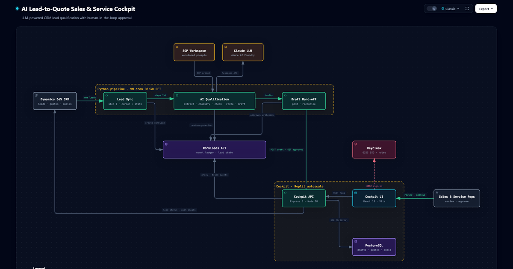

# AI Lead-to-Quote Sales & Service Cockpit

**LLM-powered CRM lead qualification with human-in-the-loop approval.**

**[View the interactive architecture diagram](https://YOUR-USERNAME.github.io/ai-lead-to-quote-cockpit-architecture/)**: zoom and pan, switch between light and dark themes, trace paths, and export to PNG or SVG.

> This repository hosts the architecture diagram of a production system built for an industrial machinery manufacturer. The application source code is private. Names of the client and internal infrastructure have been left out.

---

## The problem

A global B2B sales team receives hundreds of inbound inquiries a month through its CRM. Every lead needs the same repetitive work before a rep can start selling: reading the inquiry, pulling out technical requirements, deciding which product line fits, checking for missing information, assigning the right sales rep, and writing a qualification email. Open quotes also need regular follow-ups.

## The solution

The system has two parts:

1. **An AI qualification pipeline** that runs every day. It reads new CRM leads, has an LLM qualify each one, and produces a draft email.
2. **A web cockpit** where sales and service reps review, edit, approve or reject every AI draft before anything reaches a customer.

The AI does the repetitive groundwork, and a person still approves every email.

## Architecture walkthrough

| # | Stage | What happens |
|---|-------|--------------|
| 1 | **Lead Sync** | A cron job pulls open leads from **Microsoft Dynamics 365** (OAuth 2.0) and creates a workload in the event ledger. A sync cursor ensures no lead is skipped. |
| 2–6 | **AI Qualification** | **Claude** (via Azure AI Foundry) extracts 16 structured fields, classifies the inquiry, checks it against material-specific completeness checklists, routes it to a rep, and drafts a qualification email. |
| — | **SOP-driven prompts** | Standard operating procedures are fetched from a versioned SOP workspace at runtime and used as the system prompt. Business rules change without a code deploy. |
| 7 | **Draft hand-off** | Drafts are posted to the cockpit API (API-key protected) and land in an approval queue. |
| — | **Human review** | Reps sign in with Keycloak (OIDC SSO), then edit, approve or reject each draft. Rejections are tagged with a category such as wrong tone, wrong product or hallucination. |
| 8 | **Reconcile** | The next pipeline run fetches approved drafts and writes the decision back to the event ledger. |
| — | **CRM write-back** | The cockpit reads live lead status from Dynamics and pushes approved emails and follow-ups back as CRM activities, retrying on failure. |

### Quote follow-up

Open quotes are synced into PostgreSQL. Follow-up emails for stale opportunities go through the same review-and-approve flow in the cockpit before they are pushed to the CRM.

## Tech stack

| Layer | Technologies |
|-------|--------------|
| AI pipeline | Python 3.11, Claude (Azure AI Foundry), cron |
| Cockpit backend | Node.js 20, Express 5, TypeScript, Drizzle ORM |
| Cockpit frontend | React 18, Vite, Tailwind CSS, Radix UI, i18n (DE/EN) |
| Data | PostgreSQL 16, an event-ledger Workloads API |
| Integrations | Microsoft Dynamics 365 Web API, SOP workspace API |
| Auth & security | Keycloak (OIDC SSO, role-based access), API-key service auth |
| Delivery | Replit autoscale (cockpit), Linux VM (pipeline), GitLab CI (build + tests) |

## Key design decisions

- **Human in the loop:** no AI-generated email reaches a customer without a rep's approval.
- **Dual-write state:** the event ledger is the source of truth for pipeline state, and the cockpit database is the source of truth for approval state. Neither side queries the other's store directly.
- **Prompts as managed content:** SOPs are versioned outside the code and loaded at runtime, so business owners can tune AI behaviour.
- **Safe by default:** every step has a dry-run mode, leads older than 90 days get no auto-draft, a safety stop halts the run on mass CRM drift, and a kill switch disables live CRM reads.
- **Idempotent and resumable:** read-merge-write metadata updates, concurrent-run guards, and the ability to resume from any pipeline step.

## My role

<!-- Describe your contribution, e.g. "Designed and built the approval workflow, the CRM integration and the cockpit UI." -->

## About the diagram

The diagram was generated with [Archify](https://github.com/tt-a1i/archify) from a typed JSON specification traced against the real codebase. `index.html` is a single self-contained file with no external dependencies.
